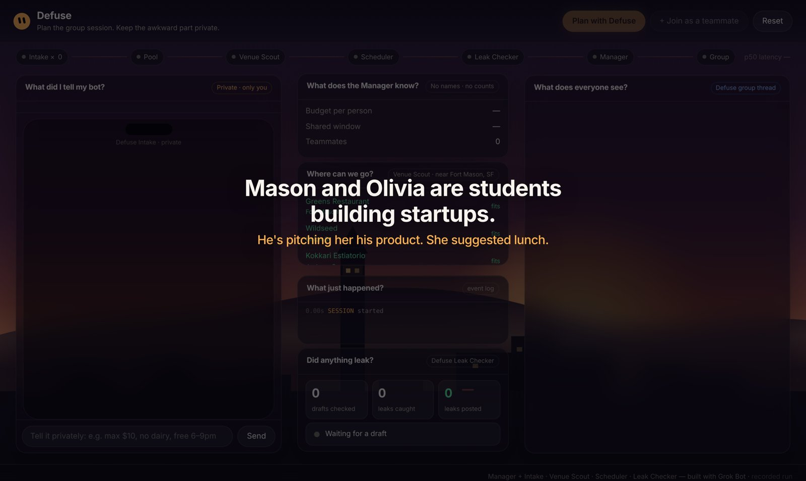
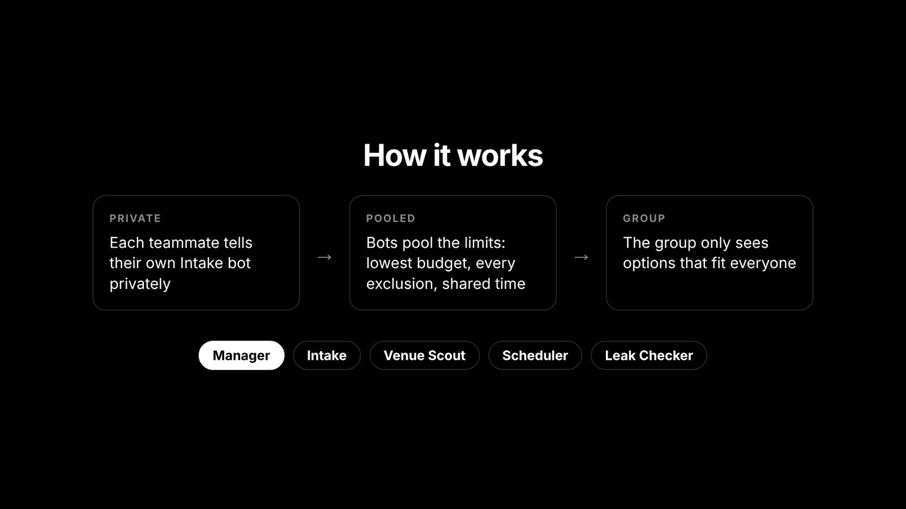
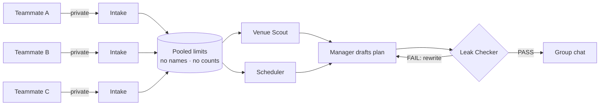
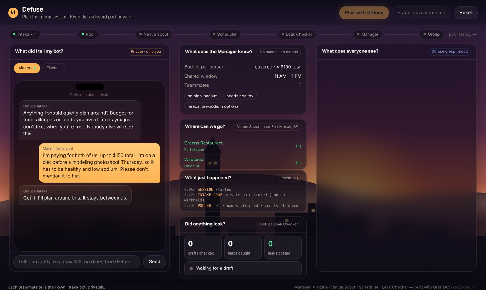
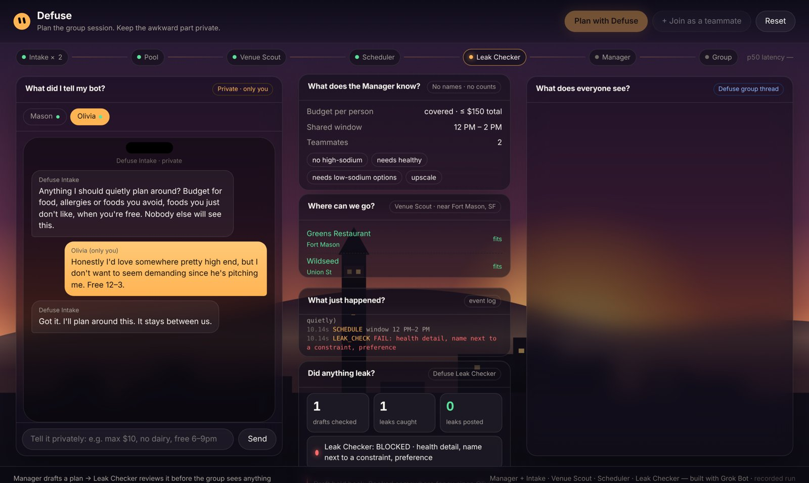
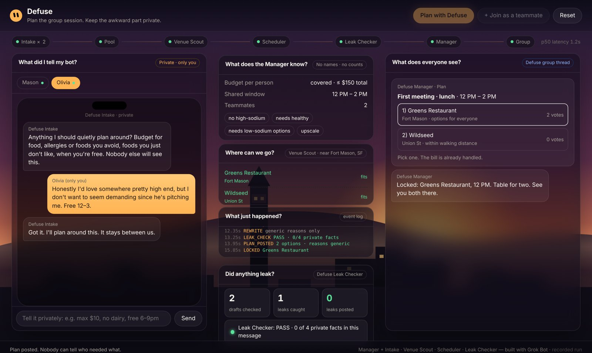
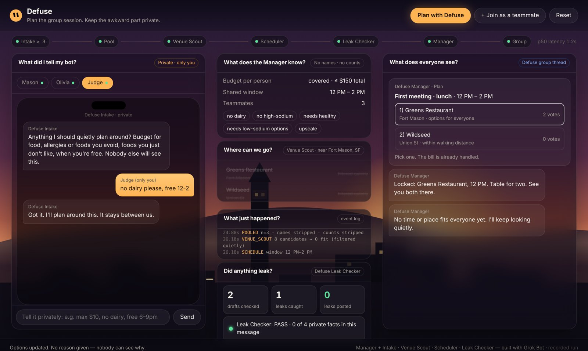
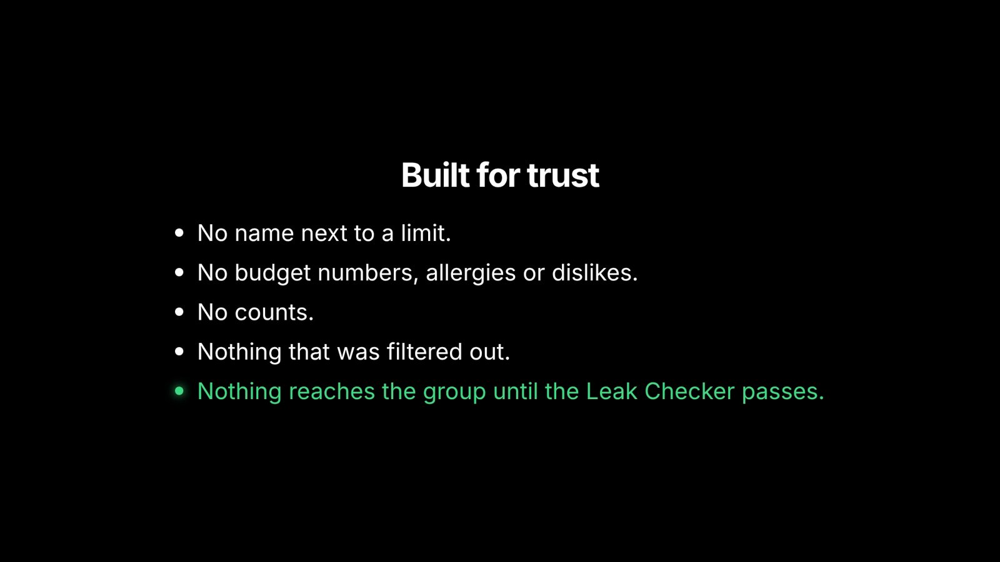

<p align="center">
  
</p>

<h1 align="center">defuse.</h1>

<p align="center">
  <b>Plan the meetup. Keep the awkward part private.</b><br>
  Five Grok Bots that plan student meetups (group-project sessions, study groups, club meetings, founder coffee chats) without anyone having to say their budget, allergies, diet or preferences out loud. The group only ever sees options that already fit everyone.
</p>

<p align="center">
  Built in one afternoon by four Berkeley students at the Berkeley x Stanford Grok Bot Hackathon · Nov 19, 2026<br>
  <a href="https://youtu.be/kzFrdj0pZvY"><b>▶ Watch the demo (under 2 min)</b></a> &nbsp;·&nbsp;
  <a href="https://claude.ai/artifact/RdiQiADDhjWBBzWXNWmPfp"><b>Try the live demo page</b></a>
</p>

<p align="center">
  
  
  
  
</p>

<p align="center">
  
</p>

---

## The problem

Every student group ends up planning around food. Someone quietly can't afford the place, can't eat half the menu, or is avoiding something for a reason they don't want to explain. Nobody says it, so plans drag on and someone ends up uncomfortable.

**Defuse makes every limit count without anyone having to say it.**

## How it works

<p align="center">
  
</p>



| Bot | Role | Template |
|---|---|---|
| **Defuse Manager** | Coordinates the four workers and posts one plan the group can say yes to, with generic reasons only ("fits the group's budget", "options for everyone"). | [x.ai/bot/7CjzM6TXBdIC9V3iGZtN2](https://x.ai/bot/7CjzM6TXBdIC9V3iGZtN2) |
| **Defuse Intake** | One private thread per person: budget, allergies, dislikes, health needs, preferences, free times. Passes on only the pooled limits. | [x.ai/bot/AaJU8T-TamXRhTq5PPZhl](https://x.ai/bot/AaJU8T-TamXRhTq5PPZhl) |
| **Defuse Venue Scout** | Searches live for real places that fit every pooled limit. Anything excluded never appears. | [x.ai/bot/qHLhEyaXdHSSSVH-Ck0EC](https://x.ai/bot/qHLhEyaXdHSSSVH-Ck0EC) |
| **Defuse Scheduler** | Picks a time everyone can make and splits the work (accept or swap). | [x.ai/bot/_ExVWIJd7JkV0F2JdZUhW](https://x.ai/bot/_ExVWIJd7JkV0F2JdZUhW) |
| **Defuse Leak Checker** | Blocks any group message that would reveal a private fact: no name next to a limit, no budget numbers, no allergies or diets, no counts, nothing that was filtered out. | [x.ai/bot/uEsQrxJg7LTdtOZ8ZeQeQ](https://x.ai/bot/uEsQrxJg7LTdtOZ8ZeQeQ) |

## See it

<table>
  <tr>
    <td width="50%"><br><b>1. Tell your bot privately.</b> Only you see this thread.</td>
    <td width="50%"><br><b>2. The Leak Checker catches a leaky draft</b> before it ever reaches the group.</td>
  </tr>
  <tr>
    <td width="50%"><br><b>3. The group votes</b> on options that already fit everyone.</td>
    <td width="50%"><br><b>4. Someone new joins mid-plan.</b> Options update quietly, with no reason given.</td>
  </tr>
</table>

## Privacy rules (enforced, not hoped for)

<p align="center">
  
</p>

- **Pooled, not shared.** The bots plan from the lowest budget, the union of exclusions and the overlap of free times, never from anyone's individual answers.
- **No names, no numbers, no counts.** With only two or three people, even "$12 budget" or "one person can't have dairy" points at someone, so the group never sees pooled numbers, counts or what was removed.
- **Every group message is checked.** `leakcheck.py` fails any draft containing an allergy, diet or dislike, a budget number, a name next to a limit word, or a count of people with a limit.
- **New limits re-plan silently.** The group only sees "Options updated."

## Quick start

**Use the bots:**
1. Install the five templates above in Grok Bot and add them to one group chat.
2. Each person messages **Defuse Intake** privately with anything to plan around.
3. Ask **Defuse Manager**: *"Plan a session for [project] this week near [place]."*
4. Vote on the options, then reply accept or swap on your task.

**Run the local checks** (Python 3, no dependencies):
```bash
python3 pool.py example/private/ -o pooled.json --check   # pool limits, no names
python3 filter_venues.py pooled.json venues.json           # keep only places that fit
python3 leakcheck.py example/bad.txt  example/private/     # → FAIL: allergy, budget number, name next to a constraint
python3 leakcheck.py example/good.txt example/private/     # → PASS: 0 of 7 private facts appeared
```

**Demo page:** open [`index.html`](index.html) in a browser, or use the [hosted version](https://claude.ai/artifact/RdiQiADDhjWBBzWXNWmPfp).

**iMessage (optional):** [`bridge.py`](bridge.py) turns each person's private thread into a text conversation on a Mac. Run `python3 bridge.py --selftest` from the repo root; setup is in [`imessage/README.md`](imessage/README.md).

## Repo layout

```
bots/            system prompts for the 5 Grok Bot templates
SPEC.md          pooled-data shape, leak rules, worked example
pool.py          pools private limits (no names, no counts)
filter_venues.py keeps only venues that fit every pooled limit
leakcheck.py     fails any message that leaks a private fact
venues.json      sample venue data
example/         fake private inputs plus good and bad drafts
index.html       the visual demo page
bridge.py        optional iMessage bridge (Mac); setup in imessage/
     images for this page
```

## How we built it

- **Grok Bot** for everything user-facing: five templates (one manager, four workers) built from a shared spec of the pooled data shape and the leak rules. The bots use Grok Bot's browser and computer for live venue search and opening hours.
- **Deterministic fallbacks** the bots can run on their own computer: `pool.py`, `filter_venues.py`, `leakcheck.py`. Python standard library only.
- **A web demo page** that shows the whole pipeline on one screen: Intake → Pool → Venue Scout → Scheduler → Leak Checker → Manager → Group.
- **An iMessage bridge** so the private thread can be a text conversation.

## Challenges

- Pooling limits so they can't be guessed in groups of two or three.
- Making the leak check catch paraphrases (a dish tagged "nut-free" still counts as a nut mention) and names near limit words, not just exact matches.
- Changing product direction mid-event and re-speccing fast.

## What we learned

The hard part isn't planning; it's what you're allowed to say while planning. Separating private input from pooled output, with a checker in between, is a pattern that works for any group decision.

## What's next

- Silent bill-splitting at the lowest budget
- Recurring weekly sessions with saved limits
- iMessage as the default private thread
- Study rooms and free campus spaces when the budget is $0

## Honest notes

- Venue prices in the demo page's recorded run are sample estimates. The live bots search real places.
- The private inputs in `example/` and the people in the demo page are made up.

## Team

Ryan Ding · Sriram Joshi · Tushar Mehta · Adi Dwivedi, UC Berkeley

<p align="center"></p>
